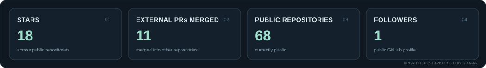

  <h1>gongfpp</h1>
  
个人开发者 · Web / Desktop / Android

> 主要开发实用软件和开发者工具。这里整理我持续维护的项目，以及对其他开源项目的代码贡献。

  

## Selected Projects

<table>
  <tr>
    <td width="50%" valign="top">
      <h3><a href="https://github.com/gongfpp/kurumi-fx-pages">久留美外汇</a> · <a href="https://gongfpp.github.io/kurumi-fx-pages/">在线体验</a></h3>
      
外汇模拟游戏的公开试玩版；源码与测试资料保留在私有仓库。

      Web · 游戏
    </td>
    <td width="50%" valign="top">
      <h3><a href="https://github.com/gongfpp/NetBall">流量悬浮球 NetBall</a></h3>
      
macOS 实时网络流量监控，可查看应用流量，并识别 Clash / mihomo 代理背后的真实应用。

      macOS · 网络工具
    </td>
  </tr>
  <tr>
    <td width="50%" valign="top">
      <h3><a href="https://github.com/gongfpp/aki-agent-kit">aki-agent-kit</a></h3>
      
中文 AI 开发 Skills 与规则，覆盖项目启动、计划、审计、README 和任务交接。

      Shell · Agent Skills
    </td>
    <td width="50%" valign="top">
      <h3><a href="https://github.com/gongfpp/NovelFish">NovelFish</a> · <a href="https://gongfpp.github.io/NovelFish/">在线体验</a></h3>
      
藏在「深度思考」里的小说阅读器，界面参考 DeepSeek 网页版的摸鱼工具（非官方项目）。

      Web · 阅读工具
    </td>
  </tr>
  <tr>
    <td width="50%" valign="top">
      <h3><a href="https://github.com/gongfpp/poor-map">穷鬼地图</a> · <a href="https://gongfpp.github.io/poor-map/">在线体验</a></h3>
      
发现附近折扣门店与优惠活动；门店、价格和库存信息以页面核验说明为准。

      React · TypeScript · 高德地图
    </td>
    <td width="50%" valign="top">
      <h3><a href="https://github.com/gongfpp/interface-atlas">界面图谱 Interface Atlas</a> · <a href="https://gongfpp.github.io/interface-atlas-web/">在线体验</a></h3>
      
前端设计概念百科与交互参考库，包含组件、动效示例和可用于 Agent 的 Prompt。

      Astro · React · TypeScript
    </td>
  </tr>
  <tr>
    <td width="50%" valign="top">
      <h3><a href="https://github.com/gongfpp/monkey-shakespeare-web">猿与莎士比亚</a> · <a href="https://gongfpp.github.io/monkey-shakespeare-web/">在线体验</a></h3>
      
像素风增量经营游戏的 Godot Web 试玩版；源码位于私有仓库。

      Godot · Web 游戏
    </td>
    <td width="50%" valign="top">
      
更多项目见我的<a href="https://github.com/gongfpp?tab=repositories">公开仓库</a>。

    </td>
  </tr>
</table>

## Open Source Contributions

以下仅列出对**其他组织/作者项目**提交并已合并的 PR，不包含我自己的仓库。

<table>
  <tr>
    <td width="50%" valign="top">
      <h3><a href="https://github.com/langgenius/dify/pull/44055">Dify #44055</a></h3>
      
用 Pydantic <code>TypeAdapter</code> 校验 Provider 配置缓存数据，减少手写解析与类型判断。

      MERGED · 42 checks passed
    </td>
    <td width="50%" valign="top">
      <h3><a href="https://github.com/morluto/rea/pull/2941">REA #2941</a></h3>
      
复用 JavaScript 语义分析中的稳定查找结果，减少重复计算并保持该样例的 IR 输出一致。

      MERGED
    </td>
  </tr>
</table>

---

统计卡由 GitHub Actions 每日从公开 API 自动更新；数据可能有一天左右的刷新延迟。项目状态与功能范围以各仓库和在线页面为准。
