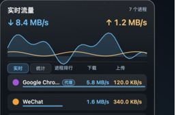
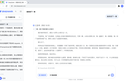

  <h1>gongfpp</h1>
  
个人开发者 · Web / Desktop / Android

> 主要开发实用软件和开发者工具。这里整理我持续维护的项目，以及对其他项目的开源贡献。

  

## Selected Projects

<table>
  <tr>
    <td width="420" valign="top">
      
      <strong><a href="https://github.com/gongfpp/kurumi-fx-pages">久留美外汇</a></strong> 
      外汇模拟游戏，在行情与剧情中体验交易。 
      Web · 游戏 · 公开试玩版 
      <a href="https://github.com/gongfpp/kurumi-fx-pages">仓库</a> · <a href="https://gongfpp.github.io/kurumi-fx-pages/">在线体验 ↗</a>
    </td>
    <td width="420" valign="top">
      
      <strong><a href="https://github.com/gongfpp/NetBall">流量悬浮球 NetBall</a></strong> 
      macOS 菜单栏与悬浮球，随时查看应用流量。 
      macOS · 网络工具 
      <a href="https://github.com/gongfpp/NetBall">仓库</a> · <a href="https://github.com/gongfpp/NetBall/releases/latest">下载最新版 ↗</a>
    </td>
  </tr>
  <tr>
    <td width="420" valign="top">
      
      <strong><a href="https://github.com/gongfpp/aki-agent-kit">aki-agent-kit</a></strong> 
      中文 AI 开发 Skills 与规则，覆盖项目全流程。 
      Shell · Agent Skills 
      <a href="https://github.com/gongfpp/aki-agent-kit">仓库 ↗</a>
    </td>
    <td width="420" valign="top">
      
      <strong><a href="https://github.com/gongfpp/NovelFish">NovelFish</a></strong> 
      把小说藏进「深度思考」里，DeepSeek 风格摸鱼工具。 
      Web · 阅读工具 · 非官方 
      <a href="https://github.com/gongfpp/NovelFish">仓库</a> · <a href="https://gongfpp.github.io/NovelFish/">在线体验 ↗</a>
    </td>
  </tr>
  <tr>
    <td width="420" valign="top">
      
      <strong><a href="https://github.com/gongfpp/poor-map">穷鬼地图</a></strong> 
      发现附近的折扣门店与优惠活动。 
      React · TypeScript · 高德地图 
      <a href="https://github.com/gongfpp/poor-map">仓库</a> · <a href="https://gongfpp.github.io/poor-map/">在线体验 ↗</a>
    </td>
    <td width="420" valign="top">
      
      <strong><a href="https://github.com/gongfpp/interface-atlas">界面图谱 Interface Atlas</a></strong> 
      前端设计概念、交互示例与 Agent Prompt 参考库。 
      Astro · React · TypeScript 
      <a href="https://github.com/gongfpp/interface-atlas">仓库</a> · <a href="https://gongfpp.github.io/interface-atlas-web/">在线体验 ↗</a>
    </td>
  </tr>
  <tr>
    <td width="420" valign="top">
      
      <strong><a href="https://github.com/gongfpp/monkey-shakespeare-web">猿与莎士比亚</a></strong> 
      从一间工作室开始的像素风增量经营游戏。 
      Godot · Web 游戏 · 公开试玩版 
      <a href="https://github.com/gongfpp/monkey-shakespeare-web">仓库</a> · <a href="https://gongfpp.github.io/monkey-shakespeare-web/">在线体验 ↗</a>
    </td>
    <td width="420" valign="top">
      
      <strong><a href="https://github.com/gongfpp/dsh-novel-fish">DSH 小说摸鱼</a></strong> 
      在真实聊天的思考与工具区域续读本地小说，不发送给模型。 
      DSH 插件 · 本地阅读 · 非官方 
      <a href="https://github.com/gongfpp/dsh-novel-fish">仓库</a> · <a href="https://github.com/gongfpp/dsh-novel-fish/releases/latest">安装与发布 ↗</a>
    </td>
  </tr>
</table>

[浏览全部公开仓库 →](https://github.com/gongfpp?tab=repositories)

## Open Source Contributions

截至 **2026-10-30（UTC+8）**，对 **4 个其他组织 / 作者项目**有 **12 个公开已合并 PR**，不包含自己的仓库。插件目录收录与更新单独列出，不计作 DSH 核心代码贡献。

| 项目 | 已合并 PR | 贡献方向 |
| --- | --- | --- |
| [**REA**](https://github.com/morluto/rea) morluto / rea | [**8 merged ↗**](https://github.com/morluto/rea/pulls?q=is%3Apr+author%3Agongfpp+is%3Amerged) | 浏览器采集一致性 · MCP / CLI · JavaScript / WASM 分析 · CI 示例 |
| [**Dify**](https://github.com/langgenius/dify) langgenius / dify | [**1 merged ↗**](https://github.com/langgenius/dify/pulls?q=is%3Apr+author%3Agongfpp+is%3Amerged) | Provider 配置缓存 · Pydantic 类型校验 |
| [**Awesome DSH Plugin**](https://github.com/awesome-dsh-plugin/awesome-dsh-plugin) awesome-dsh-plugin / awesome-dsh-plugin | [**2 merged ↗**](https://github.com/awesome-dsh-plugin/awesome-dsh-plugin/pulls?q=is%3Apr+author%3Agongfpp+is%3Amerged) | 小说摸鱼插件收录 · 预构建发布地址更新 |
| [**Awesome DeepSeek Harness Plugins**](https://github.com/imsai-sh/awesome-deepseek-harness-plugins) imsai-sh / awesome-deepseek-harness-plugins | [**1 merged ↗**](https://github.com/imsai-sh/awesome-deepseek-harness-plugins/pulls?q=is%3Apr+author%3Agongfpp+is%3Amerged) | 小说摸鱼本地阅读插件收录 |

展开全部 12 个 PR 的具体贡献

### REA · 8 个已合并

- [#6802](https://github.com/morluto/rea/pull/6802)：修复 WASM glue 中查询串或片段含行分隔符时的引用遗漏，并保留 UTF-16 坐标与候选关联。
- [#6496](https://github.com/morluto/rea/pull/6496)：补充可复用的静态分析 CI 示例，保留 JSON / 错误报告与原始退出码，并补回归测试。
- [#6358](https://github.com/morluto/rea/pull/6358)：补记采集过程中迟到的脚本元数据，避免不完整的页面脚本快照被误判为 unchanged。
- [#6341](https://github.com/morluto/rea/pull/6341)：保留 JavaScript 存储值的 UTF-16 码元，避免不同字符串被错误地判为相同。
- [#6298](https://github.com/morluto/rea/pull/6298)：让进程比较结果保留 contradiction 状态，拒绝把互相矛盾的汇总误判为验证成功。
- [#4661](https://github.com/morluto/rea/pull/4661)：统一 MCP 与 CLI 的浏览器场景输入错误格式，并补充 MCP 回归测试。
- [#4663](https://github.com/morluto/rea/pull/4663)：ADB 权限信息不完整时明确标记为 partial，避免把未知状态误报为完整的零权限。
- [#2941](https://github.com/morluto/rea/pull/2941)：复用 JavaScript 语义分析中的稳定查找结果，减少重复计算并保持该样例的 IR 输出一致。

### Dify · 1 个已合并

- [#44055](https://github.com/langgenius/dify/pull/44055)：用 Pydantic `TypeAdapter` 校验 Provider 配置缓存数据，减少手写解析与类型判断。

### Awesome DSH Plugin · 2 个已合并

- [#10407](https://github.com/awesome-dsh-plugin/awesome-dsh-plugin/pull/10407)：将小说摸鱼的预构建发布地址更新至 0.1.5。
- [#9655](https://github.com/awesome-dsh-plugin/awesome-dsh-plugin/pull/9655)：收录小说摸鱼插件，并固定 GitHub Release 安装包地址。

### Awesome DeepSeek Harness Plugins · 1 个已合并

- [#707](https://github.com/imsai-sh/awesome-deepseek-harness-plugins/pull/707)：将支持本地 EPUB / TXT / Markdown 阅读的小说摸鱼插件收录进社区目录。

---

统计卡由 GitHub Actions 每日从公开 API 自动更新，日期使用 UTC；数据可能有一天左右的刷新延迟。贡献表与 PR 介绍为上方核验日期的记录，最新列表可点击各项目的已合并数量查看。缩略图与图标来自项目公开截图或素材，项目状态与功能范围以各仓库和在线页面为准；游戏源码不在公开试玩仓库中，门店与优惠信息以地图页面核验说明为准。
