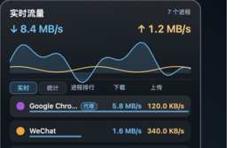
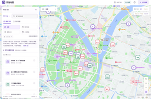

  <h1>gongfpp</h1>
  
独立开发者 · Web / Desktop / Android

主要开发实用软件、AI 开发工具和独立游戏，也参与开源项目的修复与改进。

**欢迎交流远程工作机会与项目合作**，方向包括 Web 应用、桌面工具和 AI 相关开发。

[个人网站 ↗](https://gongfpp.github.io/)

  

## Selected Projects

<table>
  <tr>
    <td width="420" valign="top">
      
      <strong><a href="https://github.com/gongfpp/kurumi-fx-pages">久留美外汇</a></strong> 
      外汇模拟游戏，在行情与剧情中体验交易。 
      Web · 游戏 · 公开试玩版 
      <a href="https://github.com/gongfpp/kurumi-fx-pages">仓库</a> · <a href="https://gongfpp.github.io/kurumi-fx-pages/">在线体验 ↗</a>
    </td>
    <td width="420" valign="top">
      
      <strong><a href="https://github.com/gongfpp/NetBall">流量悬浮球 NetBall</a></strong> 
      macOS 菜单栏与悬浮球，随时查看应用流量。 
      macOS · 网络工具 
      <a href="https://github.com/gongfpp/NetBall">仓库</a> · <a href="https://github.com/gongfpp/NetBall/releases/latest">下载最新版 ↗</a>
    </td>
  </tr>
  <tr>
    <td width="420" valign="top">
      
      <strong><a href="https://github.com/gongfpp/aki-agent-kit">aki-agent-kit</a></strong> 
      中文 AI 开发 Skills 与规则，覆盖项目全流程。 
      Shell · Agent Skills 
      <a href="https://github.com/gongfpp/aki-agent-kit">仓库 ↗</a>
    </td>
    <td width="420" valign="top">
      <strong>DSH 插件</strong> 
      <a href="https://github.com/gongfpp/dsh-novel-fish">小说摸鱼 ↗</a>：在思考与工具区域续读本地小说，不发送给模型。 
      <a href="https://github.com/gongfpp/dsh-cost-voice">大白饭到账语音播报 ↗</a>：每轮结束，默认用「大白饭」音色播报估算花费，可切换支付宝音色。 
      <a href="https://github.com/gongfpp/dsh-thanks-carl">谢谢卡尔 ↗</a>：任务完成彩蛋与常驻桌宠，附喝水、吃饭和休息提醒。 
      DeepSeek Harness · 非官方插件
    </td>
  </tr>
  <tr>
    <td width="420" valign="top">
      
      <strong><a href="https://github.com/gongfpp/poor-map">穷鬼地图</a></strong> 
      发现附近的折扣门店与优惠活动。 
      React · TypeScript · 高德地图 
      <a href="https://github.com/gongfpp/poor-map">仓库</a> · <a href="https://gongfpp.github.io/poor-map/">在线体验 ↗</a>
    </td>
    <td width="420" valign="top">
      
      <strong><a href="https://github.com/gongfpp/interface-atlas">界面图谱 Interface Atlas</a></strong> 
      前端设计概念、交互示例与 Agent Prompt 参考库。 
      Astro · React · TypeScript 
      <a href="https://github.com/gongfpp/interface-atlas">仓库</a> · <a href="https://gongfpp.github.io/interface-atlas-web/">在线体验 ↗</a>
    </td>
  </tr>
  <tr>
    <td colspan="2" valign="top">
      
      <strong><a href="https://github.com/gongfpp/monkey-shakespeare-web">猿与莎士比亚</a></strong> 
      从一间工作室开始的像素风增量经营游戏。 
      Godot · Web 游戏 · 公开试玩版 
      <a href="https://github.com/gongfpp/monkey-shakespeare-web">仓库</a> · <a href="https://gongfpp.github.io/monkey-shakespeare-web/">在线体验 ↗</a>
    </td>
  </tr>
</table>

[浏览全部公开仓库 →](https://github.com/gongfpp?tab=repositories)

## Open Source Contributions

截至 **2026-11-11（UTC+8）**，向 **6 个外部项目**提交的 **20 个 PR 已合并**，涉及浏览器采集、静态分析、AI 请求兼容、插件生命周期与无障碍体验；不含自己的仓库及插件目录收录与维护。

| 项目 | 解决的问题与改进 | 已合并 PR |
| --- | --- | --- |
| [**REA**](https://github.com/morluto/rea) | 修复脚本快照、UTF-16 / WASM 引用与路由静态推断问题；保留 Markdown 表格的 Unicode 空白，改进 MCP / CLI 诊断与 CI 示例。 | [10 merged ↗](https://github.com/morluto/rea/pulls?q=is%3Apr+author%3Agongfpp+is%3Amerged) |
| [**DSH Market**](https://github.com/dsh-market/dsh-market) | 修复重复挂载、重装后提示不消失、重启原因误报，以及 GIF 封面静止；超限封面回退到静态图。 | [4 merged ↗](https://github.com/dsh-market/dsh-market/pulls?q=is%3Apr+author%3Agongfpp+is%3Amerged) |
| [**billion-context**](https://github.com/ranxianglei/billion-context) | 保留 Responses 客户端的消息角色；补齐 DSH WebSocket 逐帧发送前准备与过期连接身份检查。 | [2 merged ↗](https://github.com/ranxianglei/billion-context/pulls?q=is%3Apr+author%3Agongfpp+is%3Amerged) |
| [**Remotion**](https://github.com/remotion-dev/remotion) | 为 Studio 图标菜单补充无障碍名称，并通过依赖更新移除 Lambda 客户端内嵌的易受攻击 XML 解析器。 | [2 merged ↗](https://github.com/remotion-dev/remotion/pulls?q=is%3Apr+author%3Agongfpp+is%3Amerged) |
| [**Atlas**](https://github.com/tryatlas/atlas) | 让反馈面板的匿名开关更易识别，并向辅助技术提供稳定名称与开关状态。 | [1 merged ↗](https://github.com/tryatlas/atlas/pulls?q=is%3Apr+author%3Agongfpp+is%3Amerged) |
| [**Dify**](https://github.com/langgenius/dify) | 用 Pydantic `TypeAdapter` 校验 Provider 配置缓存，减少手写解析与类型判断。 | [1 merged ↗](https://github.com/langgenius/dify/pulls?q=is%3Apr+author%3Agongfpp+is%3Amerged) |

查看这 20 个 PR 的具体贡献

### REA · 10 个已合并

- [#8915](https://github.com/morluto/rea/pull/8915)：保留 Markdown 表格首尾的 Unicode 空白，避免不同键值被渲染成相同内容，并避免长文本处理的性能退化。
- [#6802](https://github.com/morluto/rea/pull/6802)：修复 WASM glue 中查询串或片段含行分隔符时的引用遗漏，并保留 UTF-16 坐标与候选关联。
- [#6778](https://github.com/morluto/rea/pull/6778)：在共享解析器中将未证明运行时隔离的程序级 `var` 标记为未知，避免从可被全局对象改写的初始值推断出确定路由。
- [#6496](https://github.com/morluto/rea/pull/6496)：补充可复用的静态分析 CI 示例，保留 JSON / 错误报告与原始退出码，并补回归测试。
- [#6358](https://github.com/morluto/rea/pull/6358)：补记采集过程中迟到的脚本元数据，避免不完整的页面脚本快照被误判为 unchanged。
- [#6341](https://github.com/morluto/rea/pull/6341)：保留 JavaScript 存储值的 UTF-16 码元，避免不同字符串被错误地判为相同。
- [#6298](https://github.com/morluto/rea/pull/6298)：让进程比较结果保留 contradiction 状态，拒绝把互相矛盾的汇总误判为验证成功。
- [#4661](https://github.com/morluto/rea/pull/4661)：统一 MCP 与 CLI 的浏览器场景输入错误格式，并补充 MCP 回归测试。
- [#4663](https://github.com/morluto/rea/pull/4663)：ADB 权限信息不完整时明确标记为 partial，避免把未知状态误报为完整的零权限。
- [#2941](https://github.com/morluto/rea/pull/2941)：复用 JavaScript 语义分析中的稳定查找结果，减少重复计算并保持该样例的 IR 输出一致。

### DSH Market · 4 个已合并

- [#1165](https://github.com/dsh-market/dsh-market/pull/1165)：按实际安装的包名清理「声明已移除」提示，避免目录显示名与包名不同时重装后仍保留旧提示。
- [#1145](https://github.com/dsh-market/dsh-market/pull/1145)：按插件声明读取 patch，并根据实际结构解释需要重启的原因，不再一律归因于配置或表达式。
- [#1141](https://github.com/dsh-market/dsh-market/pull/1141)：跳过已由 bundle 层挂载的客户端包，避免重复注册服务。
- [#1126](https://github.com/dsh-market/dsh-market/pull/1126)：让精选 GIF 封面以动画 WebP 显示；超过解码限制时回退到静态缩略图，避免封面损坏。

### billion-context · 2 个已合并

- [#6064](https://github.com/ranxianglei/billion-context/pull/6064)：重建 Responses 输入时保留客户端首段 `system` / `developer` 角色，避免向不支持 `developer` 的上游发送错误角色。
- [#5840](https://github.com/ranxianglei/billion-context/pull/5840)：在既有 DSH WebSocket 接入修复上补齐逐帧发送前的请求体准备，并检查缓存连接的身份、模型与激活状态，拒绝以过期元数据发送。

### Remotion · 2 个已合并

- [#12960](https://github.com/remotion-dev/remotion/pull/12960)：为 Studio 左上角的纯图标菜单按钮补充可访问名称，保持文本菜单原有命名行为。
- [#12943](https://github.com/remotion-dev/remotion/pull/12943)：更新 `@aws-sdk/xml-builder` 的依赖覆盖，移除 `@remotion/lambda-client` 中内嵌的易受攻击 `fast-xml-parser` 副本。

### Atlas · 1 个已合并

- [#406](https://github.com/tryatlas/atlas/pull/406)：为反馈面板的匿名开关补充悬停提示、开关语义与稳定的无障碍名称，使可点击性和当前状态更明确。

### Dify · 1 个已合并

- [#44055](https://github.com/langgenius/dify/pull/44055)：用 Pydantic `TypeAdapter` 校验 Provider 配置缓存数据，减少手写解析与类型判断。

生态参与：社区插件目录收录与维护

### [小说摸鱼](https://github.com/gongfpp/dsh-novel-fish)

收录渠道：[Awesome DSH Plugin](https://github.com/awesome-dsh-plugin/awesome-dsh-plugin/pull/9655) · [Awesome DeepSeek Harness Plugins](https://github.com/imsai-sh/awesome-deepseek-harness-plugins/pull/707) · [DSH Community Plugins](https://github.com/zhu1090093659/dsh-community-plugins/pull/60)

发布地址维护：[0.1.5](https://github.com/awesome-dsh-plugin/awesome-dsh-plugin/pull/10407) · [1.0.1](https://github.com/awesome-dsh-plugin/awesome-dsh-plugin/pull/12228)

### [大白饭到账语音播报](https://github.com/gongfpp/dsh-cost-voice)

收录渠道：[Awesome DSH Plugin](https://github.com/awesome-dsh-plugin/awesome-dsh-plugin/pull/12155) · [Awesome DeepSeek Harness Plugins](https://github.com/imsai-sh/awesome-deepseek-harness-plugins/pull/832) · [DSH Community Plugins](https://github.com/zhu1090093659/dsh-community-plugins/pull/84)

目录信息维护：[更新名称与默认音色](https://github.com/awesome-dsh-plugin/awesome-dsh-plugin/pull/13678)

### [谢谢卡尔](https://github.com/gongfpp/dsh-thanks-carl)

收录渠道：[Awesome DSH Plugin](https://github.com/awesome-dsh-plugin/awesome-dsh-plugin/pull/12015) · [Awesome DeepSeek Harness Plugins](https://github.com/imsai-sh/awesome-deepseek-harness-plugins/pull/833) · [DSH Community Plugins](https://github.com/zhu1090093659/dsh-community-plugins/pull/85)

---

统计卡由 GitHub Actions 每日从公开 API 自动更新，外部 PR 数排除自己的仓库及生态参与中列出的三个插件目录；日期使用 UTC，数据可能有一天左右的刷新延迟。代码贡献表与明细为上方核验日期的记录，最新列表可点击各项目的已合并数量查看。缩略图与图标来自项目公开截图或素材，项目状态与功能范围以各仓库和在线页面为准；游戏源码不在公开试玩仓库中，门店与优惠信息以地图页面核验说明为准。
